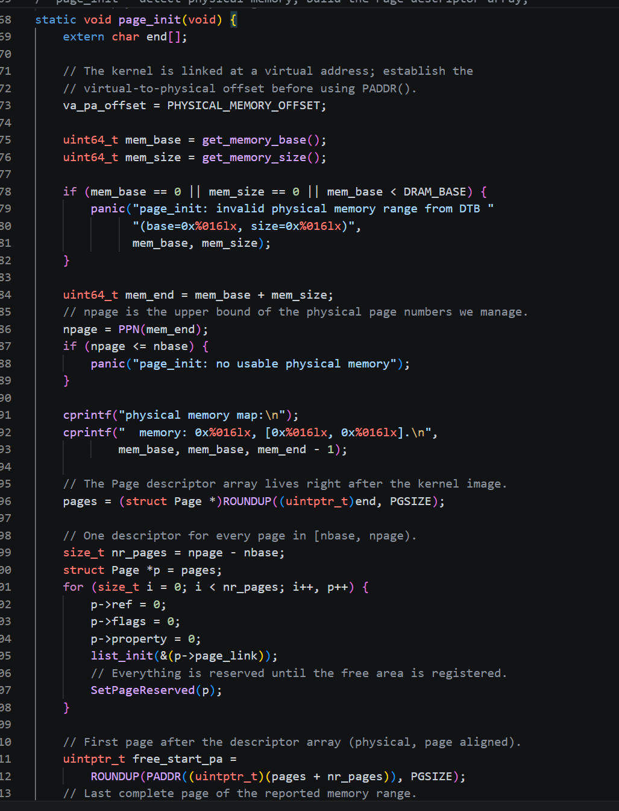
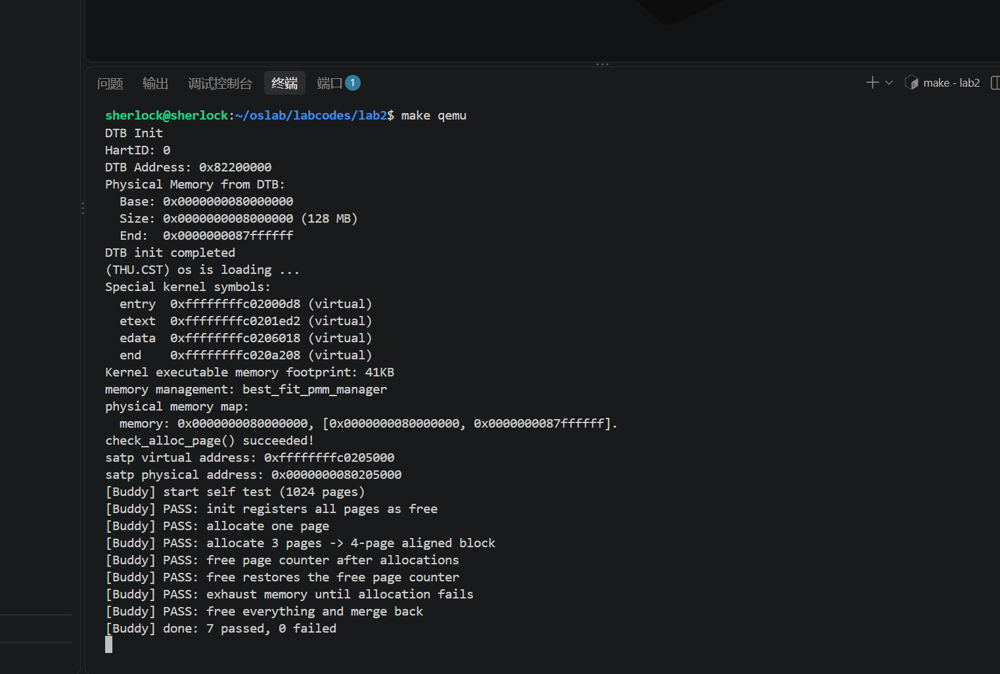
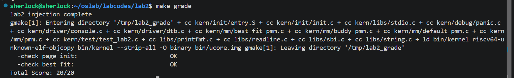
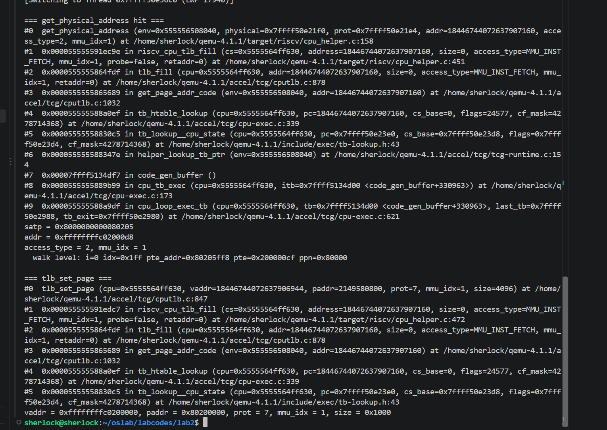
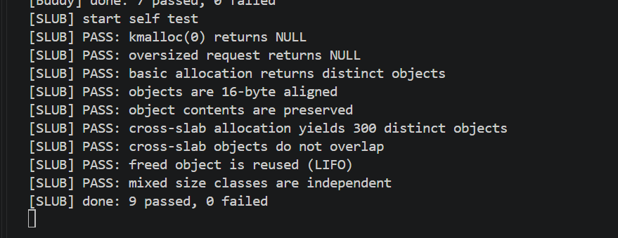

# 实验报告

## 实验基本信息

| 项目 | 内容 |
|------|------|
| **实验名称** | Lab 2: 物理内存和页表 |
| **小组成员** | 2513871-吴君瑶、2514108-闫子浚、2513273-陈睿鹏 |
| **完成日期** | 2026-10-22 |

### 小组分工

练习如何分工？

| 成员 | 负责的练习/模块 |
|------|----------------|
| 2513871-吴君瑶 | 功能模块一：`page_init()` 与物理内存探测；功能模块二任务二：Best-Fit；Challenge：SLUB；报告统稿 |
| 2514108-闫子浚 | 功能模块二任务一：First-Fit 分析；功能模块二任务三：Buddy System 模块与测试 |
| 2513273-陈睿鹏 | 实验环境、编译运行与测试验证；分支任务：双重 GDB 调试 QEMU 地址翻译 |

实验报告如何分工？

本实验报告由全组共同完成：2513871-吴君瑶 负责功能模块一、Best-Fit、SLUB 与报告统稿；2514108-闫子浚 负责 First-Fit 分析与 Buddy System 部分；2513273-陈睿鹏 负责实验环境、测试截图与分支任务部分；最后由三人共同校对。

---

## 一、实验目的

本实验的主要目的是：

1. 理解页表的建立和使用方法：内核在 `entry.S` 中建立启动页表并开启 Sv39 分页，此后所有代码都运行在虚拟地址空间中。
2. 理解物理内存的管理方法：内核如何从设备树获知物理内存范围，如何用 `Page` 描述符数组描述每一个物理页，如何把已占用和未使用的内存区分开。
3. 理解页面分配算法：在 First-Fit 的基础上实现 Best-Fit，并用 Buddy System 理解按 2 的幂拆分与合并的思想。
4. 理解任意大小内存对象的分配：用 SLUB 的两层架构把页级分配扩展到对象级分配。
5. 理解模拟器内部机制：用双重 GDB 观察 QEMU 如何模拟 TLB 查找与 Sv39 页表遍历。

---

## 二、实验环境

**硬件与软件环境**

| 项目 | 内容 |
|------|------|
| 主机环境 | Windows 11 + WSL2（Ubuntu） |
| 交叉编译器 | `riscv64-unknown-elf-gcc` 10.2.0（SiFive GCC-Metal 10.2.0-2020.12.8） |
| 内核调试器 | `riscv64-unknown-elf-gdb` 10.1.0（SiFive GDB-Metal 10.1.0-2020.12.7） |
| 宿主调试器 | GNU gdb 15.1（用于调试 x86-64 的 QEMU 进程） |
| 模拟器 | QEMU 4.1.1（正式版安装于 `/usr/local/bin`，调试版编译于 `~/qemu-4.1.1/riscv64-softmmu`） |
| 目标机器 | QEMU Virt Machine（RV64ACDFIMSU，8 个 HART） |
| 固件 | QEMU 内置 OpenSBI v0.4 |
| 代码目录 | `~/oslab/labcodes/lab2` |

你们使用的 AI 工具

| 成员 | AI 编程工具 | 底层模型 | 备注 |
|------|------------|---------|------|
| 2513871-吴君瑶 | Claude Code（终端 Agent，运行于 VS Code + WSL Ubuntu）、Codex | DeepSeek API、Codex | 使用 cc-switch 管理 API 配置 |
| 2514108-闫子浚 | Claude Code | Claude Code | |
| 2513273-陈睿鹏 | Claude Code | Claude Code | |

**说明：**
- **AI 编程工具**：指具体使用的终端工具、编辑器插件、桌面应用或浏览器界面
- **底层模型**：指该工具使用的大语言模型及版本

---

## 三、实验整体逻辑分析

### 2.1 本章节的逻辑主线

lab1 结束时，内核已经能在虚拟地址空间中运行、能通过 SBI 输出字符，但它对"内存"一无所知：不知道自己有多少内存、哪些能用、哪些已经被自己占用。lab2 要解决的就是这个问题——**让内核认识并管理物理内存**。

整个实验围绕一条链条展开：

```
设备树告诉内核"这台机器有多少内存"
        ↓
内核为每个物理页建立一个 Page 描述符
        ↓
把 OpenSBI、内核镜像、描述符数组占用的页标记为"保留"
        ↓
剩下的完整页交给 pmm_manager 管理
        ↓
pmm_manager 用某种分配算法（First-Fit / Best-Fit / Buddy）分配和回收页面
        ↓
在页分配之上再用 SLUB 提供任意大小的对象分配
```

本章的核心问题是：**在一块已经被分页机制映射过的虚拟地址空间里，如何准确地描述、保留、分配物理页，并进一步在其上构造对象分配器。**

### 2.2 功能的逐步实现

1. **先建立分页机制**（`kern/init/entry.S`）。lab2 的 `entry.S` 在跳入 `kern_init` 之前，把 `boot_page_table_sv39` 的物理页号写入 `satp` 并执行 `sfence.vma`，内核从此运行在 Sv39 虚拟地址空间中。
2. **再获取物理内存范围**（`dtb_init()`）。OpenSBI 把设备树地址放在 `a1` 寄存器中，`entry.S` 保存到 `boot_dtb`；`dtb_init()` 解析设备树，得到 `memory_base` 和 `memory_size`。
3. **然后选择物理内存管理器**（`init_pmm_manager()`）。`pmm_manager` 用函数指针把"初始化、建立空闲区、分配、释放、统计、自检"抽象成统一接口。
4. **接着建立页描述符与空闲区**（`page_init()`）。确定 `npage`、放置 `pages` 数组、把所有页先标为保留，再把描述符数组之后的完整页面交给 `init_memmap()`。
5. **最后实现具体分配算法**。First-Fit 已有完整实现，作为参考；Best-Fit 需要自己实现并切换；Buddy System 需要从零设计模块与测试；SLUB 在页分配之上再实现对象分配。
6. **在调试层面**，用双重 GDB 观察 QEMU 内部如何完成地址翻译，把"软件模拟硬件"的过程看清楚。

内核启动后的输出顺序正好对应前五步：

```
DTB Init
Physical Memory from DTB:
  Base: 0x0000000080000000
  Size: 0x0000000008000000 (128 MB)
...
memory management: best_fit_pmm_manager
physical memory map:
  memory: 0x0000000080000000, [0x0000000080000000, 0x0000000087ffffff].
check_alloc_page() succeeded!
satp virtual address: 0xffffffffc0205000
satp physical address: 0x0000000080205000
```

---

## 四、实验内容与实现

### 4.0 分页机制的关键设计问题

指导书提出了六个需要思考的问题，结合 `entry.S` 与运行结果回答如下：

1. **哪些物理内存空间需要建立页映射关系？**
   本实验需要让内核访问整块 DRAM `[0x80000000, 0x88000000)`（128MB）。此外 OpenSBI、MMIO 设备等也位于物理地址空间中，但 lab2 只需要保证内核能访问 DRAM 与自身代码。

2. **具体的页映射关系是什么？**
   采用"等偏移映射"：虚拟地址 `0xFFFFFFFFC0000000 + x` 映射到物理地址 `0x80000000 + x`，偏移量为 `PHYSICAL_MEMORY_OFFSET = 0xFFFFFFFF40000000`。这样内核里的虚拟地址减去偏移就是物理地址。

3. **页目录表的起始地址设置在哪里？**
   `boot_page_table_sv39` 定义在 `entry.S` 的 `.data` 段中，按 4KB 对齐。它的物理地址被写入 `satp`，运行日志显示为 `0x80205000`。

4. **页表的起始地址设置在哪里，需要多大空间？**
   本实验只使用了一张 4KB 的根页表。因为采用 1GB 巨型页映射，不需要第二、三级页表；如果使用 4KB 页，则还需要额外分配下级页表。

5. **如何设置页目录表项的内容？**
   根页表的最后一项（索引 511）被设置为 `(0x80000 << 10) | 0xcf`：PPN 为 `0x80000`（物理地址 `0x80000000`），低位置 V/R/W/X/A/D 全部为 1。

6. **如何设置页表项的内容？**
   由于是巨型页，第 5 问的页目录项本身就是叶子页表项，不再有下级页表。它的 `R/W/X` 表示可读可写可执行，`A/D` 表示已访问、已修改。

### 功能模块一：物理内存探测与 Page 描述符初始化

**负责人：** 2513871-吴君瑶

#### 核心数据结构

```c
struct Page {
    int ref;                 // 引用计数
    uint64_t flags;          // PG_reserved / PG_property
    unsigned int property;   // 空闲块包含的连续页数（仅块首页有效）
    list_entry_t page_link;  // 空闲链表节点
};

struct Page *pages;    // 描述符数组首地址（虚拟地址）
size_t npage;          // 可管理物理页号上界
uint64_t va_pa_offset; // 虚拟地址到物理地址的偏移
const size_t nbase;    // DRAM 起始页号 = DRAM_BASE / PGSIZE
```

#### 实现思路

`page_init()` 分四步：

1. **确定地址偏移**：`va_pa_offset = PHYSICAL_MEMORY_OFFSET`。`PADDR()` 就是用"虚拟地址减 va_pa_offset"得到物理地址，所以必须最先设置。
2. **确定页号上界**：从 `get_memory_base()` / `get_memory_size()` 取出设备树报告的范围，校验有效性后令 `npage = PPN(mem_base + mem_size)`。
3. **放置描述符数组**：`pages = ROUNDUP(end, PGSIZE)`，数组长度为 `npage - nbase`，覆盖 `[nbase, npage)`。每个 `Page` 先全部设为保留，并初始化 `ref`、`property`、`page_link`。
4. **注册空闲区**：空闲区从描述符数组末尾之后开始：

```c
uintptr_t free_start_pa = ROUNDUP(PADDR((uintptr_t)(pages + nr_pages)), PGSIZE);
uintptr_t free_end_pa   = ROUNDDOWN(mem_end, PGSIZE);
if (free_start_pa < free_end_pa) {
    size_t n = (free_end_pa - free_start_pa) / PGSIZE;
    init_memmap(pa2page(free_start_pa), n);
}
```

注意 `pages + nr_pages` 是**虚拟地址**，必须先经 `PADDR()` 转成物理地址才能和内存末端比较。

#### 关键实现

```c
static void page_init(void) {
    extern char end[];
    va_pa_offset = PHYSICAL_MEMORY_OFFSET;

    uint64_t mem_base = get_memory_base();
    uint64_t mem_size = get_memory_size();
    if (mem_base == 0 || mem_size == 0 || mem_base < DRAM_BASE) {
        panic("page_init: invalid physical memory range from DTB");
    }

    uint64_t mem_end = mem_base + mem_size;
    npage = PPN(mem_end);

    cprintf("physical memory map:\n");
    cprintf("  memory: 0x%016lx, [0x%016lx, 0x%016lx].\n",
            mem_base, mem_base, mem_end - 1);

    pages = (struct Page *)ROUNDUP((uintptr_t)end, PGSIZE);
    size_t nr_pages = npage - nbase;
    for (struct Page *p = pages; p != pages + nr_pages; p ++) {
        p->ref = 0; p->flags = 0; p->property = 0;
        list_init(&(p->page_link));
        SetPageReserved(p);
    }

    uintptr_t free_start_pa =
        ROUNDUP(PADDR((uintptr_t)(pages + nr_pages)), PGSIZE);
    uintptr_t free_end_pa = ROUNDDOWN(mem_end, PGSIZE);
    if (free_start_pa < free_end_pa) {
        init_memmap(pa2page(free_start_pa),
                    (free_end_pa - free_start_pa) / PGSIZE);
    }
}
```



#### 扩展 Challenge：如果 OS 无法提前知道可用物理内存范围，有什么办法获取？

有几种常见思路：

1. **由固件/引导程序告知**（本实验的做法）。OpenSBI 通过设备树（DTB）把内存范围告诉内核；x86 上则由 UEFI 提供内存映射表。
2. **查询固件提供的标准接口**。例如 x86 的 BIOS `INT 15h, EAX=E820` 可以返回物理内存布局，UEFI 也有 `GetMemoryMap()`。
3. **读取硬件寄存器**。部分平台的 DRAM 控制器寄存器会记录内存容量，内核可以读取。
4. **主动探测**。在候选地址写入特征值再读回，能读回则说明该地址可写。早期 PC 常用这种方法，但需要异常处理来跳过不存在的地址，风险较高。
5. **通过 ACPI 等描述表**。ACPI 的 SRAT、E820 等表可以提供内存拓扑信息。
6. **由虚拟化平台提供**。QEMU 通过 `fw_cfg`、设备树或 hypervisor 调用把内存信息交给 guest。

本实验选择第 1 种，因为它最可靠：内核不需要猜测，直接解析固件已经扫描好的设备树即可。

#### 实现中遇到的问题

**`end` 未声明**：链接脚本用 `PROVIDE(end = .)` 导出符号，C 编译器看不到，需要在函数内写 `extern char end[];`。

---

### 功能模块二：物理内存分配

#### 任务一：First-Fit 分析（思考题）

**负责人：** 2514108-闫子浚

**`default_init()`**：把空闲链表头初始化为空，`nr_free` 清零。只清理管理结构，不碰物理页。

**`default_init_memmap(base, n)`**：逐个检查这些页确实处于 `PG_reserved`，然后清零 `flags`、`property`、引用计数；把 `base->property` 设为 `n` 并设置 `PG_property`，表示"从 base 开始的 n 页是一个空闲块"；最后按地址顺序插入空闲链表，`nr_free += n`。

**`default_alloc_pages(n)`**：`n > nr_free` 直接失败；否则从头遍历空闲链表，**找到第一个** `property >= n` 的块。恰好等于 n 就整块摘除；更大就把块首 n 页切走，剩下的 `base + n` 作为新块首页插回链表。最后 `nr_free -= n`，清除被分配块首页的 `PG_property`。

**`default_free_pages(base, n)`**：清零这 n 页的 `flags`、`property`、引用计数；把 `base` 作为新空闲块按地址顺序插入，`nr_free += n`；然后检查前一个块是否满足 `prev + prev->property == base`，满足就合并；再检查后一个块是否紧接在合并后的块之后，满足就继续合并。

**First-Fit 的改进空间：**

1. **查找复杂度**：每次分配都从头线性扫描，最坏 O(n)。可以按块大小分档，或用平衡树/线段树维护，把查找降到 O(log n)。
2. **碎片问题**：First-Fit 倾向于切碎低地址的大块，长期运行会留下大量小碎片。可以改用 Next-Fit，或配合定期整理。
3. **索引结构**：当前链表按地址排序，便于合并但不利于按大小查找。可以同时维护"按地址"和"按大小"两套索引。

---

#### 任务二：Best-Fit 连续物理内存分配器

**负责人：** 2513871-吴君瑶

**设计思路：**

Best-Fit 与 First-Fit 的唯一区别是"选哪一块"：First-Fit 遇到第一个够大的就用；Best-Fit 要遍历整条空闲链表，在所有 `property >= n` 的块中选择 `property` 最小的那一块。

模块内部状态与 First-Fit 一致：

```c
static free_area_t free_area;
#define free_list (free_area.free_list)
#define nr_free   (free_area.nr_free)
```

这两个宏名不能改，因为框架测试直接使用了 `free_list` 和 `nr_free`。

**分配核心：**

```c
struct Page *best = NULL;
list_entry_t *le = &free_list;
while ((le = list_next(le)) != &free_list) {
    struct Page *p = le2page(le, page_link);
    if (p->property >= n) {
        if (best == NULL || p->property < best->property) {
            best = p;
        }
    }
}
```

找到后从链表摘除；若还有剩余，把 `best + n` 作为新块首页插回原位置；最后 `nr_free -= n`、清除 `PG_property`。释放逻辑与 First-Fit 相同：按地址插入并合并相邻块。

**Best-Fit 的改进空间：**

1. 线性扫描仍是 O(n)。可以用按块大小排序的平衡树（红黑树）维护，查找"最小的 >= n"只需 O(log n)。
2. 可以分档：按大小范围（1、2-3、4-7、8-15 页……）分桶，先在对应桶里找。
3. Best-Fit 会产生大量难以利用的小碎片，可以配合延迟合并或定期整理。
4. 对热点大小（如总是 1 页）可以加"最近命中块"缓存，减少重复扫描。

**验证结果：** `make grade` 输出 `[Test 2] Best-Fit: PASS`，总分 20/20。

---

#### 任务三：Buddy System（伙伴系统）

**负责人：** 2514108-闫子浚

**设计思路：**

伙伴系统把空闲内存按"阶"组织：阶 k 的块包含 2^k 个连续页，每个阶维护一条空闲链表。

- **分配**：请求页数向上取整到 2^k；从阶 k 向上找第一个非空链表；如果找到更大的块，就不断二分，把后半块挂到低一阶，直到得到阶 k 的块。
- **释放**：把块挂回对应阶，检查伙伴是否空闲且同阶；是则合并成高一阶，继续向上合并。
- **伙伴地址**：块首页页号为 `ppn`、阶为 k 时，伙伴页号为 `ppn ^ (1 << k)`。前提是块按自身大小对齐，所以初始化时必须把内存拆成对齐的 2 的幂块。

```c
#define MAX_ORDER 16                  /* 最大 2^16 页 = 256MB */
static list_entry_t free_list[MAX_ORDER];
static size_t nr_free;
static size_t free_blocks[MAX_ORDER];
```

**初始化按对齐拆分：**

```c
uintptr_t ppn = page2ppn(base);
while (n > 0) {
    size_t order = MAX_ORDER - 1;
    while (order > 0 &&
           ((((size_t)1 << order) > n) ||
            ((ppn & (((size_t)1 << order) - 1)) != 0))) {
        order --;
    }
    buddy_add_block(pa2page(ppn << PGSHIFT), order);
    ppn += ((size_t)1 << order);
    n   -= ((size_t)1 << order);
}
```

**测试覆盖（7 项）：**

1. 初始化后 1024 页全部登记为空闲；
2. 分配单页成功且 `PG_property` 为假；
3. 申请 3 页向上取整为 4 页，且块按 4 页对齐；
4. 分配后空闲页计数正确减少；
5. 释放后计数恢复；
6. 反复分配直到返回 NULL，验证耗尽路径；
7. 全部释放后能正确合并，空闲页数恢复。

这七项分别覆盖**正常分配、取整与对齐、计数一致性、耗尽边界、合并路径**，是伙伴系统最容易出错的五类场景。

**运行结果：** `7 passed, 0 failed`。

---

#### Challenge：任意大小的内存单元 SLUB 分配算法

**负责人：** 2513871-吴君瑶

**设计思路：**

SLUB 采用两层架构：

- 第一层：页级分配，复用现有 `pmm_manager`，通过 `alloc_pages(1)` 申请 4KB 页；
- 第二层：把每个页切成固定大小对象，每个 size class 对应一种对象大小。

本实验选取 16、32、64、128、256、512、1024、2048 字节共 8 个 size class。每个 class 维护空闲对象链表：

```c
struct slub_cache {
    size_t objsize;
    struct slub_free *free_list;
    size_t nr_free;
};
```

每个 slab 占一个 4KB 页，页首是 slab 头：

```c
struct slub_slab {
    uint64_t magic;              /* 0x5C0B5C0B */
    struct slub_cache *cache;
    uint32_t inuse;
    uint32_t nr_objs;
};
```

空闲对象本身用来存 `next` 指针，不需要额外元数据。

`kmalloc(size)`：找到第一个 `objsize >= size` 的 cache；有空闲对象就弹出，没有就调用 `alloc_pages(1)` 新建 slab，把页内对象全部串入空闲链表后再弹出。

`kfree(ptr)`：把指针低 12 位清零得到页首，读出 slab 头并校验 `magic`，然后把对象插回对应 cache 的空闲链表头。

**关键实现：**

```c
static struct slub_slab *
slub_new_slab(struct slub_cache *cache) {
    struct Page *page = alloc_pages(1);
    if (page == NULL) return NULL;

    uintptr_t slab_va = page2pa(page) + va_pa_offset;
    struct slub_slab *slab = (struct slub_slab *)slab_va;
    slab->magic = SLUB_MAGIC;
    slab->cache = cache;
    slab->inuse = 0;
    slab->nr_objs = (PGSIZE - SLUB_HDR) / cache->objsize;

    cache->free_list = NULL;
    cache->nr_free = 0;
    uintptr_t obj = slab_va + SLUB_HDR;
    for (uint32_t i = 0; i < slab->nr_objs; i ++) {
        struct slub_free *f = (struct slub_free *)(obj + i * cache->objsize);
        f->next = cache->free_list;
        cache->free_list = f;
        cache->nr_free ++;
    }
    return slab;
}
```

**测试覆盖（9 项）：**

1. `kmalloc(0)` 返回 NULL；
2. 超过最大 size class 的请求返回 NULL；
3. 申请 8、20、100 字节对象，返回互不相同的指针；
4. 所有对象地址 16 字节对齐；
5. 写入不同字节模式后逐字节读回，验证内容完整；
6. 连续申请 300 个 16 字节对象，超过单个 slab 容量，触发多个 slab；
7. 300 个对象地址互不相同；
8. 跨 slab 写入不同模式，验证对象不互相覆盖；
9. 释放后立即重新申请验证 LIFO 复用，并验证不同 size class 互不干扰。

这些测试覆盖了**参数边界、尺寸取整、对齐、数据隔离、跨 slab 扩展、释放复用**六类关键行为。跨 slab 测试能发现"新建 slab 时误清空已有空闲链表"的问题，数据隔离测试能发现对象重叠，LIFO 测试能发现释放回收到错误的 cache。

**运行结果：** `9 passed, 0 failed`。

---

### 分支任务：用 GDB 调试 QEMU 的地址翻译过程

**负责人：** 2513273-陈睿鹏

#### 1. 任务目标

前面调试的是"被模拟的内核"；这次往下钻一层，用宿主机的 `gdb` 调试"正在模拟这台机器的 QEMU 本身"，观察一条访存指令在 QEMU 内部如何完成 TLB 查找和页表遍历。

#### 2. 准备带调试信息的 QEMU

```bash
cd ~/qemu-4.1.1
make distclean
./configure --target-list=riscv32-softmmu,riscv64-softmmu --enable-debug
make -j$(nproc)
```

**没有执行 `make install`**，所以系统里同时存在两个 QEMU：

- `/usr/local/bin/qemu-system-riscv64`：正式版；
- `~/qemu-4.1.1/riscv64-softmmu/qemu-system-riscv64`：调试版，带 `debug_info`、not stripped。

ucore 的 Makefile 中 QEMU 变量有 `ifndef` 保护，因此可以不改 Makefile，直接用：

```bash
make debug QEMU=~/qemu-4.1.1/riscv64-softmmu/qemu-system-riscv64
```

#### 3. 双重 GDB 的分工

| 会话 | 调试器 | 目标 | 作用 |
|------|--------|------|------|
| 1 | 宿主机 `gdb`（x86-64） | QEMU 进程 | 在 `get_physical_address()` 等 C 函数下断点 |
| 2 | `riscv64-unknown-elf-gdb` | 被模拟的 ucore | 通过 1234 端口控制内核执行 |

两者不能混用：QEMU 是 x86-64 程序，RISC-V GDB 解析不了；ucore 是 RISC-V 代码，宿主 GDB 也不认识。

指导书使用 `gdb attach <PID>`，但本机 WSL 的 `ptrace_scope = 1`，普通用户不能附加到非子进程，因此改为**在宿主 GDB 下直接启动 QEMU**（让 GDB 成为父进程），调试效果等价。

#### 4. 条件断点

`get_physical_address()` 每条访存都会调用，普通断点会被打爆。选一个必定被访问的地址——`kern_init` 入口：

```bash
riscv64-unknown-elf-nm bin/kernel | grep -w kern_init
# ffffffffc02000d8
```

```gdb
break get_physical_address if addr == 0xffffffffc02000d8
```

#### 5. 实际观察到的调用路径

```
#0  get_physical_address (addr=0xffffffffc02000d8,
                          access_type=2, mmu_idx=1)
                        at target/riscv/cpu_helper.c:158
#1  riscv_cpu_tlb_fill (access_type=MMU_INST_FETCH, mmu_idx=1)
                        at target/riscv/cpu_helper.c:451
#2  tlb_fill (...)
                        at accel/tcg/cputlb.c:878
#3  get_page_addr_code (addr=0xffffffffc02000d8)
                        at accel/tcg/cputlb.c:1032
#4  tb_htable_lookup (pc=0xffffffffc02000d8)
                        at accel/tcg/cpu-exec.c:339
#5  tb_lookup__cpu_state (...)
                        at include/exec/tb-lookup.h:43
#6  helper_lookup_tb_ptr (...)
                        at accel/tcg/tcg-runtime.c:154
#7  code_gen_buffer ()
#8  cpu_tb_exec (...)
```

这说明本次翻译由**取指**触发：CPU 要执行 `kern_init`，先把它交给 `get_page_addr_code()` 做代码页翻译；TLB 未命中后进入 `tlb_fill()` → `riscv_cpu_tlb_fill()` → `get_physical_address()`。

关键数据：

```
satp        = 0x8000000000080205
addr        = 0xffffffffc02000d8
access_type = 2 (MMU_INST_FETCH)
mmu_idx     = 1 (S 模式)
```

`satp` 最高 4 位是 `1000`，即 MODE=8（Sv39）；PPN `0x80205` 对应物理地址 `0x80205000`，与启动日志一致。

#### 6. 页表遍历的实际过程

```
walk level: i=0 idx=0x1ff pte_addr=0x80205ff8 pte=0x200000cf ppn=0x80000
```

- `i = 0`：只遍历了第 0 级；
- `idx = 0x1ff`：VPN[2] = 511，正好是最后一项；
- `pte_addr = 0x80205ff8`：页表基址 `0x80205000` + 511 × 8；
- `pte = 0x200000cf`：页表项内容；
- `ppn = 0x80000`：对应物理地址 `0x80000000`。

**为什么只走一级？** `0x200000cf` 的 R/W/X 全为 1，是叶子页表项；在第 0 级命中叶子，说明这是 **1GB 巨型页**。`entry.S` 中启动页表只设置了一项 `.quad (0x80000 << 10) | 0xcf`，把 `0xffffffffc0000000` 开始的 1GB 直接映射到 `0x80000000`。

如果是普通 4KB 页，完整三级遍历为：

```
第 1 级：用 VPN[2] 在根页表找到下一级页表基址
第 2 级：用 VPN[1] 找到下一级页表基址
第 3 级：用 VPN[0] 找到叶子页表项，取出 PPN
物理地址 = (PPN << 12) | 页内偏移
```

#### 7. TLB 查找与填充

QEMU 的 TLB 查找在 `get_page_addr_code()` 中（`accel/tcg/cputlb.c`）：

```c
uintptr_t index = tlb_index(env, mmu_idx, addr);
CPUTLBEntry *entry = tlb_entry(env, mmu_idx, addr);

if (unlikely(!tlb_hit(entry->addr_code, addr))) {
    if (!VICTIM_TLB_HIT(addr_code, addr)) {
        tlb_fill(env_cpu(env), addr, 0, MMU_INST_FETCH, mmu_idx, 0);
        ...
    }
}
```

`tlb_hit()` 只有一行（`include/exec/cpu-all.h`）：

```c
return tlb_hit_page(tlb_addr, addr & TARGET_PAGE_MASK);
```

即把虚拟地址按页对齐后与 TLB 表项的标签比较。命中直接返回；未命中调用 `tlb_fill()` 走页表遍历。

遍历成功后，`riscv_cpu_tlb_fill()` 调用：

```c
tlb_set_page(cs, address & TARGET_PAGE_MASK, pa & TARGET_PAGE_MASK,
             prot, mmu_idx, TARGET_PAGE_SIZE);
```

实际输出：

```
tlb_set_page: vaddr = 0xffffffffc0200000, paddr = 0x80200000,
              prot = 7, mmu_idx = 1, size = 0x1000
```

`prot = 7` 即 `R|W|X`；`paddr = 0x80200000` 正是内核物理起点。

#### 8. QEMU 的 TLB 与真实 CPU TLB 的区别

1. **介质不同**：真实 TLB 是硬件 SRAM/CAM；QEMU 的 TLB 是 `CPUTLBEntry` 数组，本质是软件缓存。
2. **查找方式不同**：硬件并行比较，一个周期完成；QEMU 先算索引再比较标签，是串行软件过程。
3. **容量与替换不同**：硬件容量固定、组相联固定；QEMU 可配置，并有"受害者 TLB"（`VICTIM_TLB_HIT`）做二次查找。
4. **失效方式不同**：真实 CPU 由 `sfence.vma` 触发硬件刷新；QEMU 由 `tlb_flush()` 系列函数软件清空。
5. **一致性维护不同**：硬件维护 ASID/VMID；QEMU 用 `mmu_idx` 区分地址空间。
6. **语义地位不同**：真实 TLB 是体系结构的一部分；QEMU 的 TLB 只是加速模拟的缓存，全部失效也不改变程序语义，只会变慢。

这也解释了实验现象：**断点没命中可能只是因为地址已在 TLB 中**，没有走页表遍历。本实验选 `kern_init` 入口，就是因为此前从未访问过这一页，必然 TLB 未命中。

#### 9. 调试中比较有意思的细节

1. **TLB 填充发生在取指路径上**，调用栈出现 `get_page_addr_code → tb_htable_lookup → helper_lookup_tb_ptr`，是在为 `kern_init` 建立翻译块时触发翻译。
2. **"三级页表"实际只走了一级**，因为启动页表用 1GB 巨型页。多级页表的级数只是上限，实际走几级取决于页表项类型。
3. **QEMU 填入的 TLB 表项大小是 4KB**（`size = 0x1000`），尽管映射本身是 1GB 大页；QEMU 按目标页大小逐页填充。
4. **guest GDB 的 `continue` 会被宿主 GDB 的断点打断**：宿主 GDB 一停，整个 QEMU 进程（包括 gdbstub）都被暂停，RISC-V GDB 表现为连接卡住，最后显示 `Remote connection closed`。这正是"双重调试"的直观体现。

---

### 提示词设计与 AI 协作过程

#### 5.1 四段式框架

本实验所有提示词都按课程 lab0.5 要求的四段式编写：

- **[PROMPT]**：目标文件、任务目标、操作约束、输出要求；
- **[RELY]**：只放与任务直接相关的宏、结构体、全局变量、可用函数，全部从源码原样复制；
- **[GUARANTEE]**：必须实现的函数签名，以及允许新增的 static 辅助函数；
- **[SPECIFICATION]**：每个函数的 Pre-Condition / Post-Condition，并用 Case 描述正常路径、异常路径和边界情况。

完整提示词见同目录下的 `prompt.md`。

#### 5.2 每个练习的 spec 是怎么写的

**`page_init()`**：`[RELY]` 中明确 `PGSIZE`、`PPN`、`ROUNDUP`、`PADDR`、`nbase`、`npage`、`pages`、`va_pa_offset`；`[SPECIFICATION]` 把"DTB 信息无效""没有完整空闲页""正常注册空闲区"写成三个 Case，并明确要求"内核镜像和描述符数组不得进入空闲区"。

**Best-Fit**：`[RELY]` 中给出 `struct Page`、`free_area_t`、`list.h` 的接口和 `pmm_manager` 的函数指针表；`[SPECIFICATION]` 明确"选择 property 最小且 >= n 的块"，并规定 `free_list` / `nr_free` 的名字不能改，因为测试函数直接使用。

**Buddy System**：`[SPECIFICATION]` 写清 MAX_ORDER、阶的定义、拆分规则、`ppn ^ (1 << order)` 的伙伴公式、合并条件，以及"块必须按自身大小对齐"这一关键约束。

**SLUB**：`[SPECIFICATION]` 写清两层架构、size class 列表、slab 头字段、空闲对象链表、`kmalloc` 的五种情形（0、超限、有空闲、需新页、页分配失败）和 `kfree` 的三种情形（NULL、magic 不匹配、正常回收）。

#### 5.3 Buddy System 第一份 prompt：生成模块

````markdown
[PROMPT]
**任务**：新增文件 kern/mm/buddy_pmm.c 与 kern/mm/buddy_pmm.h，从零实现一个 Buddy System（伙伴系统）物理页分配模块，并按照现有 pmm_manager 框架注册为 buddy_pmm_manager，使其可以被 init_pmm_manager() 选用。

**操作要求**：你必须在项目中创建并修改实际文件，而不是只展示代码。不要修改 default_pmm.c、best_fit_pmm.c 以及它们对应的测试函数；不要破坏现有 Best-Fit 的评分路径。模块必须能被现有 Makefile 自动编译（kern/mm 目录下的 .c 会被自动收集）。

**输出要求**：直接创建文件并完成实现，保证 `make` 可以通过编译；提供的自检函数必须能够在 QEMU 中运行并输出明确的通过/失败信息。

[RELY]
// pmm_manager 接口（kern/mm/pmm.h）
struct pmm_manager {
    const char *name;
    void (*init)(void);
    void (*init_memmap)(struct Page *base, size_t n);
    struct Page *(*alloc_pages)(size_t n);
    void (*free_pages)(struct Page *base, size_t n);
    size_t (*nr_free_pages)(void);
    void (*check)(void);
};

// Page 结构（kern/mm/memlayout.h）
struct Page { int ref; uint64_t flags; unsigned int property; list_entry_t page_link; };

// 可用宏与函数
PGSIZE / PGSHIFT / PPN / npage / nbase
page2pa / pa2page / PageProperty / SetPageProperty / ClearPageProperty
PageReserved / SetPageReserved / ClearPageReserved / set_page_ref
le2page / list_init / list_empty / list_add / list_add_before / list_del / list_next / list_prev
assert / panic / cprintf

[GUARANTEE]
必须实现或修改的接口：
```c
// kern/mm/buddy_pmm.h
extern const struct pmm_manager buddy_pmm_manager;
void buddy_pmm_test(void);

// kern/mm/buddy_pmm.c
static void buddy_init(void);
static void buddy_init_memmap(struct Page *base, size_t n);
static struct Page *buddy_alloc_pages(size_t n);
static void buddy_free_pages(struct Page *base, size_t n);
static size_t buddy_nr_free_pages(void);
static void buddy_check(void);
```

你可以根据需要添加：
- static 辅助函数（如阶数计算、伙伴地址计算、块拆分与合并）
- 模块内部宏与静态变量

[SPECIFICATION]
## 总体设计
**Post-Condition**:
- 以"阶"（order）为单位组织空闲块，阶为 k 的块包含 2^k 个连续物理页；
- 为每个阶维护一条空闲链表（例如 free_list[MAX_ORDER]），并记录每阶的空闲块数量；
- 所有空闲块首页设置 PG_property，非首页不设置；
- 保留页永远不进入任何空闲链表。

## buddy_init
**Post-Condition**: 所有阶的空闲链表初始化为空，空闲页计数为 0。

## buddy_init_memmap
**Pre-Condition**: base 指向一段连续 n 页的第一页描述符，n > 0，这些页当前为保留状态。
**Post-Condition**: 这 n 页的 ref 置 0、property 清零；把这段内存按 2 的幂拆成若干个对齐的块（从大到小）分别挂到对应阶的空闲链表上；nr_free 增加 n。

## buddy_alloc_pages
**Pre-Condition**: n > 0。
**Post-Condition**: 成功时返回分配块首页描述符，块大小为目标阶对应的 2^k 页（2^k >= n），并且该块与自身大小对齐；失败返回 NULL。

  **Case 1**: n 大于当前空闲页总数，返回 NULL。
  **Case 2**: 计算满足 2^k >= n 的最小阶 k；若该阶及更高阶都没有空闲块，返回 NULL。
  **Case 3**: 在最小的可用高阶块上不断二分，把后半块挂到低一阶的空闲链表，直到得到阶 k 的块；返回该块首页并清除 PG_property。
  **Case 4**: 成功分配后，nr_free 减去 2^k。

## buddy_free_pages
**Pre-Condition**: base 是之前由本分配器返回的块首页，n > 0。
**Post-Condition**: 释放的块被挂回对应阶的空闲链表，并尽可能与同阶的空闲伙伴块合并；合并后的块继续参与更高阶的合并；nr_free 增加实际释放的页数。

  **Case 1**: 伙伴块不存在、处于已分配状态、或阶数不同，则不做合并。
  **Case 2**: 伙伴块空闲且同阶，则把两块合并为高一阶的块，重复该过程直到无法继续。

## buddy_nr_free_pages
**Post-Condition**: 返回当前空闲页总数。

## buddy_pmm_test
**Post-Condition**: 在不影响 Best-Fit 正常评分的前提下，对伙伴系统做自检，至少覆盖：初始化后空闲页数正确、单页分配与释放、多页分配向上取整、块拆分后伙伴关系正确、释放后能合并回大块、空闲页耗尽时返回 NULL。每个检查项打印 PASS/FAIL。

**Requirements**:
- 块地址必须按自身大小对齐；
- 伙伴地址可用"块首页页号异或 (1 << order)"计算；
- 允许 O(n) 复杂度，不要求性能优化；
- 不允许修改 Best-Fit 模块及其测试。
````

#### 5.4 Buddy System 第二份 prompt：生成测试

````markdown
[PROMPT]
**任务**：为上一条提示词生成的 Buddy System 分配器设计并实现一组测试函数，放在 kern/mm/buddy_pmm.c 中（或同目录的独立文件中），用于验证分配、释放、拆分、合并和边界行为是否正确。

**操作要求**：你必须在项目中修改实际文件，而不是只展示代码。测试只能调用 buddy_pmm_manager 暴露的接口或模块内部可测试的 static 函数，不得修改 default_pmm.c、best_fit_pmm.c 及其测试。

**输出要求**：测试必须能够编译运行，并在 QEMU 输出中给出每项检查的 PASS/FAIL，以及最终汇总。

[RELY]
// 被测模块接口
struct pmm_manager buddy_pmm_manager;
void buddy_pmm_test(void);

// 可观测状态
size_t nr_free_pages(void);
struct Page *alloc_pages(size_t n);
void free_pages(struct Page *base, size_t n);
page2pa / PPN / PGSIZE / PageProperty

// 断言工具
assert / cprintf

[GUARANTEE]
必须实现或修改的接口：
```c
void buddy_pmm_test(void);
```

你可以根据需要添加：
- 若干 static 测试辅助函数
- 测试专用的统计变量

[SPECIFICATION]
## buddy_pmm_test

**Pre-Condition**: buddy_pmm_manager 已经注册，且初始空闲区已经通过 init_memmap 建立。

**Post-Condition**: 依次执行下列检查，每项打印结果，最后打印总体结果；测试结束后把分配出去的页全部释放，使空闲页数恢复到测试前的值。

  **Case 1（基本分配）**: 连续分配若干单页，检查返回非空、互不相同、页号在 [nbase, npage) 内、PG_property 为假。
  **Case 2（多页与对齐）**: 申请非 2 的幂的页数（例如 3 页），检查返回块的大小被向上取整、起始页号按块大小对齐。
  **Case 3（拆分）**: 申请一个较小块后，检查更高阶的空闲块数量是否按预期减少、低阶链表是否出现拆分出的伙伴块。
  **Case 4（释放与合并）**: 释放相邻的两个同阶伙伴块，检查它们是否合并成高一阶的块，且 nr_free 恢复正确。
  **Case 5（耗尽）**: 反复分配直到返回 NULL，检查此时 nr_free 为 0 或小于最小块大小，并且不会崩溃。
  **Case 6（恢复）**: 把 Case 5 中分配的块按逆序释放，检查 nr_free 回到测试前的值，且空闲链表结构仍然合法。

**Requirements**:
- 每个 Case 都要有独立的 PASS/FAIL 输出，便于定位问题；
- 测试不得依赖固定物理地址，必须通过 page2pa/PPN 计算；
- 测试结束后不得留下泄漏的页面；
- 测试函数不能被评分脚本误触发，必须由显式的调试入口调用。
````

按照指导书要求，Buddy System 与 SLUB 各提交两份 prompt：第一份生成模块，第二份生成测试。

#### 5.5 SLUB 第一份 prompt：生成模块

````markdown
[PROMPT]
**任务**：新增文件 kern/mm/slub.c 与 kern/mm/slub.h，从零实现一个简化的 SLUB 内存对象分配器，并接入现有内核。

**操作要求**：你必须在项目中创建并修改实际文件，而不是只展示代码。不要修改 default_pmm.c、best_fit_pmm.c、buddy_pmm.c 及其测试函数；不要破坏 `make grade` 的评分路径。模块必须能被现有 Makefile 自动编译（kern/mm 下的 .c 会被自动收集）。

**输出要求**：直接创建文件并完成实现，保证 `make` 可以通过编译；提供的自检函数必须能够在 QEMU 中运行并输出明确的通过/失败信息。

[RELY]
// 第一层：页级分配器（kern/mm/pmm.h）
struct Page *alloc_pages(size_t n);
void free_pages(struct Page *base, size_t n);
uintptr_t page2pa(struct Page *page);
extern uint64_t va_pa_offset;

// 常量
#define PGSIZE 4096

// 可用的库函数
void *memset(void *s, int c, size_t n);
int cprintf(const char *fmt, ...);
void panic(const char *fmt, ...);

// 内核虚拟地址 = 物理地址 + va_pa_offset

[GUARANTEE]
必须实现或修改的接口：
```c
// kern/mm/slub.h
void slub_init(void);
void *kmalloc(size_t size);
void kfree(void *ptr);
void slub_test(void);

// kern/mm/slub.c
static void slub_init_cache(struct slub_cache *cache, size_t objsize);
static struct slub_cache *slub_cache_for(size_t size);
static struct slub_slab *slub_new_slab(struct slub_cache *cache);
static void slub_test(void);
```

你可以根据需要添加：
- static 辅助函数
- 模块内部宏与静态变量

[SPECIFICATION]
## 总体设计
**Post-Condition**:
- 实现两层架构：第一层是页级分配（调用 `alloc_pages(1)` 获取 4KB 页），第二层是在页内切分为固定大小的对象；
- 维护一组 size class（建议 16、32、64、128、256、512、1024、2048 字节），每个 size class 对应一个 cache；
- 每个 slab 占一个 4KB 页，页首存放 slab 头（magic、所属 cache 指针、inuse、对象数），之后按对象大小切分；
- 每个 cache 维护一条空闲对象链表（利用对象本身的存储空间存放 next 指针）和空闲对象计数。

## slub_init
**Post-Condition**: 所有 cache 的 objsize 被设置，空闲链表为空，计数为 0；模块标记为已初始化。

## kmalloc
**Pre-Condition**: size 为请求的字节数。
**Post-Condition**: 成功时返回一个至少 size 字节、16 字节对齐的对象指针；失败返回 NULL。

  **Case 1**: size 为 0 或大于最大 size class，返回 NULL。
  **Case 2**: 找到第一个 objsize >= size 的 cache。
  **Case 3**: 该 cache 有空闲对象时，从空闲链表弹出一个对象并返回。
  **Case 4**: 该 cache 没有空闲对象时，调用 `alloc_pages(1)` 申请一个新页，初始化 slab 头并把页内对象全部串入空闲链表，再弹出一个返回。
  **Case 5**: 页分配失败时返回 NULL。

## kfree
**Pre-Condition**: ptr 是之前由 kmalloc 返回的指针，或为 NULL。
**Post-Condition**: 对象被放回其所属 cache 的空闲链表，slab 的 inuse 减一；传入 NULL 时直接返回。

  **Case 1**: 通过 ptr 所在页的首地址找到 slab 头，校验 magic。
  **Case 2**: magic 不匹配时说明不是本分配器的对象，直接返回，不破坏内存。
  **Case 3**: magic 匹配时，把对象插回对应 cache 的空闲链表头部，计数加一。

## slub_test
**Post-Condition**: 依次执行基本分配、尺寸取整、数据完整性、跨 slab 分配、释放复用、非法参数等检查，每项打印 PASS/FAIL，最后打印汇总。

**Requirements**:
- 不得修改现有 PMM 模块及其测试；
- 对象地址必须 16 字节对齐；
- 允许简化实现（不要求 NUMA、不要求空闲 slab 回收、不要求 per-CPU cache），但必须体现两层架构；
- 测试结束后不得留下泄漏的对象。
````

#### 5.6 SLUB 第二份 prompt：生成测试

````markdown
[PROMPT]
**任务**：为上一条提示词生成的 SLUB 分配器设计并实现一组测试函数，放在 kern/mm/slub.c 中，用于验证不同大小对象的分配、释放和复用是否正确。

**操作要求**：你必须在项目中修改实际文件，而不是只展示代码。测试只能调用 `kmalloc`、`kfree`、`slub_init` 等模块接口，不得修改其他内存管理模块。

**输出要求**：测试必须能够编译运行，并在 QEMU 输出中给出每项检查的 PASS/FAIL，以及最终汇总。

[RELY]
// 被测接口
void slub_init(void);
void *kmalloc(size_t size);
void kfree(void *ptr);

// 可观测手段
cprintf / memset
uintptr_t（判断对齐）

// size class
16 / 32 / 64 / 128 / 256 / 512 / 1024 / 2048

[GUARANTEE]
必须实现或修改的接口：
```c
void slub_test(void);
```

你可以根据需要添加：
- 若干 static 测试辅助函数
- 测试专用的静态数组与计数变量

[SPECIFICATION]
## slub_test

**Pre-Condition**: SLUB 模块已经初始化，当前 PMM 中有足够的空闲页。

**Post-Condition**: 依次执行下列检查，每项打印 PASS/FAIL，最后打印总体结果；测试结束后释放所有申请的对象。

  **Case 1（非法参数）**: `kmalloc(0)` 和 `kmalloc(2049)` 都应返回 NULL。
  **Case 2（基本分配）**: 申请 8、20、100 字节的对象，均应非空、互不相同、16 字节对齐。
  **Case 3（数据完整性）**: 向三个对象分别写入不同字节模式，再逐字节读回校验，确认对象之间互不覆盖。
  **Case 4（尺寸取整）**: 申请 8 字节应落在 16 字节 class，申请 20 字节应落在 32 字节 class；可通过对象间距或连续分配行为间接验证。
  **Case 5（跨 slab）**: 连续申请 300 个 16 字节对象，应超过单个 slab 的容量，从而触发至少两个 slab；检查全部非空、地址互不相同、数据各自保持。
  **Case 6（释放与复用）**: 释放一个对象后立即按同样大小重新申请，应复用同一个地址（空闲链表 LIFO）；释放全部对象后再次申请应成功。
  **Case 7（多尺寸混合）**: 交替申请 64、128、512 字节的对象，确认不同 size class 互不干扰，释放后各自可复用。

**Requirements**:
- 每个 Case 都要有独立的 PASS/FAIL 输出；
- 测试数组必须放在静态区，避免占用只有 8KB 的内核栈；
- 测试结束后不得留下未释放对象；
- 不得依赖固定物理地址，所有地址从 kmalloc 返回值获得。
````

#### 5.7 测试覆盖与有效性说明

**Buddy System（7 项）**：初始化、单页、3 页取整与对齐、分配后计数、释放后计数、耗尽、合并恢复。覆盖了正常路径、取整与对齐、计数一致性、耗尽边界和合并路径。

**SLUB（9 项）**：非法参数、基本分配、对齐、数据完整性、跨 slab 数量、跨 slab 地址唯一、跨 slab 数据隔离、LIFO 复用、混合 size class。覆盖了参数边界、尺寸取整、对齐、数据隔离、跨 slab 扩展、释放复用。

这两组测试都不是只测"能分配"，而是分别检查了**状态计数、边界条件和对象之间的隔离**，因此能有效发现实现中的真实错误。本次 Buddy 的 `nr_free` 记账 bug 正是靠第 6、7 项测试暴露出来的。

#### 5.8 AI 生成代码时出现的 bug 与解决

**Bug 1：`page_init()` 中 `end` 未声明。**

编译报 `error: 'end' undeclared`。原因是 `end` 由链接脚本 `PROVIDE(end = .)` 导出，C 编译器看不到声明。在函数内补上 `extern char end[];` 后解决。

**Bug 2：Buddy 拆分时 `nr_free` 记账错误。**

第一版在摘下整块时没有扣减，拆分时 `buddy_add_block()` 又把拆出的部分加回去，最后再减一次请求大小，导致重复扣减。自检报出 "exhaust memory until allocation fails" 和 "free everything and merge back" 两项失败。

修正为"摘块时先减 2^found，拆分时加回拆出部分，最后不再减"，自检从 5 通过 2 失败变为 7 通过 0 失败。

#### 5.9 分支任务中大模型的作用

分支任务使用了 5 条提示词：总体方案、带调试信息 QEMU 的编译、源码定位、条件断点、TLB 对比。大模型主要帮助解决了：

1. 搞清两个 GDB 分别调试什么，宿主机必须用 x86 的 `gdb`；
2. 解释 `--enable-debug` 与 `make install` 的关系，避免覆盖正式版；
3. 在 `cpu_helper.c` 中定位 `get_physical_address()` 与 `riscv_cpu_tlb_fill()`，并给出条件断点写法。

---

## 五、测试与验证

**测试一：编译**

执行 `make`，所有源文件编译通过，最后输出 `ld bin/kernel` 与 `objcopy ... bin/ucore.img`。

**测试二：运行（`make qemu`）**



输出中可以看到设备树报告的 128MB 物理内存、当前管理器 `best_fit_pmm_manager`、物理内存布局、`check_alloc_page() succeeded!`，以及 `satp` 的虚拟/物理地址。

**测试三：官方评测（`make grade`）**



```
  -check page init:                          OK
  -check best fit:                           OK
Total Score: 20/20
```

**测试四：Buddy System 自检**

Buddy 的自检输出包含在 `make qemu` 的启动日志中，7 项全部 PASS，0 项 FAIL：

```
[Buddy] start self test (1024 pages)
[Buddy] PASS: init registers all pages as free
[Buddy] PASS: allocate one page
[Buddy] PASS: allocate 3 pages -> 4-page aligned block
[Buddy] PASS: free page counter after allocations
[Buddy] PASS: free restores the free page counter
[Buddy] PASS: exhaust memory until allocation fails
[Buddy] PASS: free everything and merge back
[Buddy] done: 7 passed, 0 failed
```

**测试五：分支任务的双重 GDB 调试**



宿主机 GDB 在 `get_physical_address()` 命中，调用栈显示 `tlb_fill → riscv_cpu_tlb_fill → get_physical_address`；遍历只走了一级（1GB 巨型页），最终 `tlb_set_page` 把 `0xffffffffc0200000` 映射到 `0x80200000`。

**测试六：SLUB 自检**



9 项检查全部 PASS，0 项 FAIL；接入 SLUB 后 `make grade` 仍为 20/20。

---

## 六、实验总结与收获

### 对操作系统的理解

**1. 本实验中重要的知识点，及其与 OS 原理中知识点的对应关系**

1. **Page 描述符数组**，对应 OS 原理中的"物理页框管理"。原理上每个物理页框有一个描述符，记录引用计数、状态和空闲链表指针；本实验的 `struct Page` 是这种描述符的最简形式。

2. **设备树（DTB）探测物理内存**，对应 OS 原理中的"内存探测与初始化"。原理上内核通过固件提供的硬件描述信息获知内存布局；本实验把这一步交给 OpenSBI 生成的设备树。

3. **First-Fit / Best-Fit 空闲链表**，对应 OS 原理中的"连续内存分配算法"。原理上用空闲分区表管理内存；本实验应用在 4KB 页粒度上，没有内部碎片，但有外部碎片。

4. **Buddy System**，对应 OS 原理中的"伙伴系统"。原理上按 2 的幂管理内存块，通过异或找伙伴实现快速合并；本实验在页粒度上实现。

5. **SLUB 两层架构**，对应 OS 原理中的"slab 分配器"。原理上先按页向伙伴系统申请内存，再在页内切分固定大小对象；本实验用 8 个 size class 和空闲对象链表实现了最简版本。

6. **`va_pa_offset` 与 `PADDR()`**，对应 OS 原理中的"虚拟地址到物理地址的转换"。原理上由 MMU 查页表完成；本实验采用等偏移映射，可以直接用减法计算。

7. **`PG_reserved` 与 `PG_property`**，对应 OS 原理中的"页框状态管理"。本实验用两个标志位区分保留页和空闲块首页。

8. **TLB 与页表遍历**，对应 OS 原理中的"地址转换与 TLB"。原理上由硬件 MMU 完成；本实验通过 QEMU 的软件模拟观察了其完整过程。

**2. OS 原理中重要、但在本实验中未对应上的知识点**

1. **多级页表的动态管理**：只用了启动时建立的一张根页表，没有实现页表创建、修改和 TLB 刷新策略；
2. **按需调页与页面置换**：没有缺页异常处理，也没有页面回收；
3. **进程与地址空间隔离**：没有进程控制块，所有代码在同一个地址空间运行；
4. **内存回收与换出**：没有 swap；
5. **并发与锁**：分配器没有加锁，因为当前是单核顺序执行；
6. **碎片整理**：没有实现内存紧凑；
7. **NUMA 与 per-CPU cache**：SLUB 未实现这些高级特性。

### AI 协作开发的经验

1. **`[RELY]` 必须"抄"不能"编"**。`page_init()` 能一次编译通过，关键是把 `PGSIZE`、`PPN`、`ROUNDUP`、`PADDR`、`nbase`、`npage` 这些真实符号原样写进提示词。

2. **`[SPECIFICATION]` 的 Case 决定代码质量**。Buddy 的 bug 就出在"拆分"这个 Case 没有把计数规则写死，AI 只关注链表操作，忽略了 `nr_free` 的收支平衡。

3. **自检函数是 AI 生成代码的"照妖镜"**。Buddy 的两个失败项不是编译错误，而是运行时的计数错误；没有 7 项自检，这个 bug 很可能潜伏到后面的实验。

4. **AI 负责写，人负责验证**。本次每一块代码都经过 `make`、`make qemu`、`make grade` 三重验证，报告中的每个结论都对应终端里真实出现过的输出。
