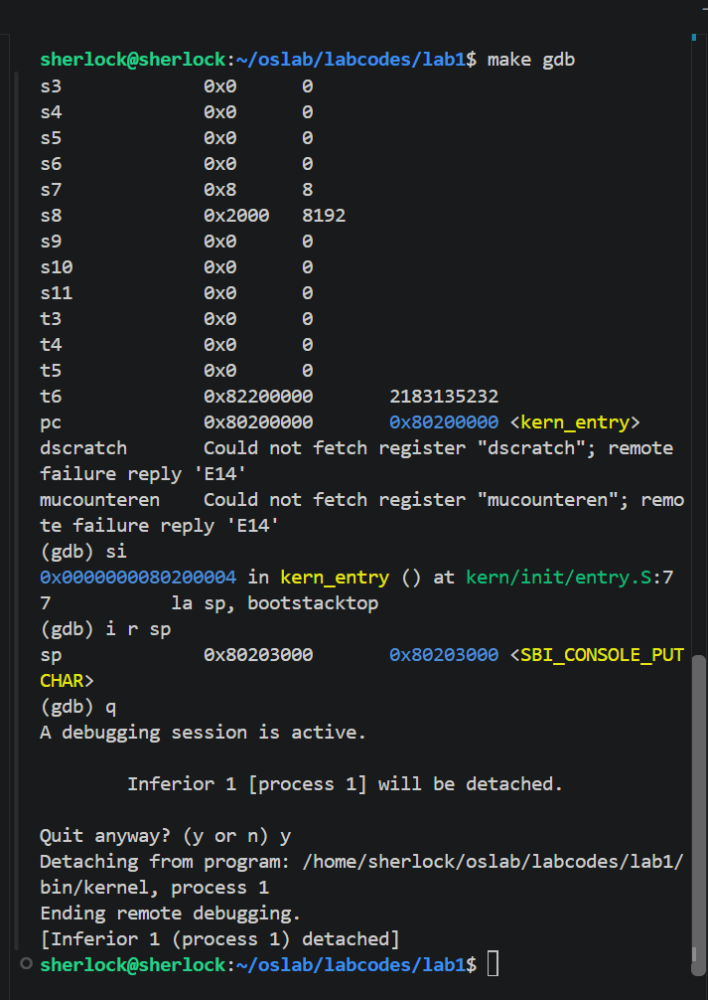
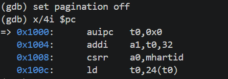
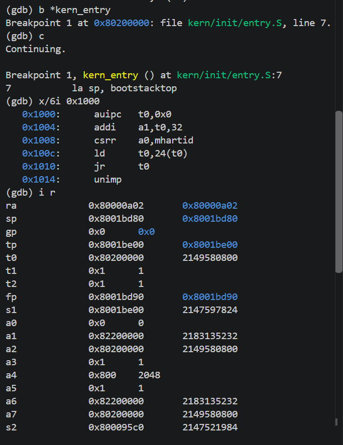
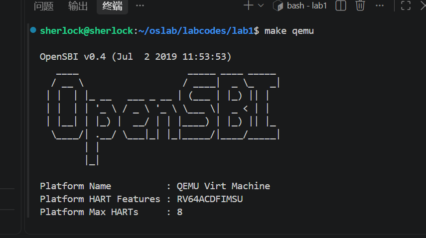
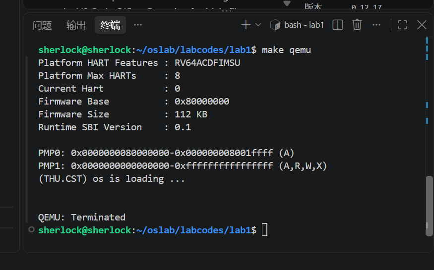

# 实验报告

## 实验基本信息

| 项目 | 内容 |
|------|------|
| **实验名称** | Lab 1: 比麻雀更小的麻雀（最小可执行内核） |
| **小组成员** | 2513871-吴君瑶、2514108-闫子浚、2513273-陈睿鹏 |
| **完成日期** | 2026-10-07 |

### 小组分工

练习如何分工？

| 成员 | 负责的练习/模块 |
|------|----------------|
| 2513871-吴君瑶 | 练习 1：内核入口指令分析（`la sp` 与 `tail kern_init`）；实验整体统筹与报告统稿 |
| 2514108-闫子浚 | 练习 2：使用 GDB 验证启动流程 |
| 2513273-陈睿鹏 | 实验环境搭建、内核编译与运行验证（`make` / `make qemu`）、测试截图整理 |

实验报告如何分工？

本实验报告由全组共同完成：2513871-吴君瑶 负责练习 1 的内容与报告统稿，2514108-闫子浚 负责练习 2 的内容整理，2513273-陈睿鹏 负责实验环境、编译运行与测试截图部分的整理，最后由三人共同校对。

---

## 一、实验目的

本实验的主要目的是：

1. 理解 QEMU 模拟的 64 位 RISC-V 计算机从上电复位到内核执行第一条指令的完整启动流程；
2. 掌握用链接脚本描述内存布局、用交叉编译生成内核镜像、用 OpenSBI 作为 bootloader 加载内核的方法；
3. 掌握使用 OpenSBI 提供的服务在屏幕上格式化输出字符串的方法，为后续实验提供调试手段；
4. 学会使用 QEMU + GDB 远程调试内核，能够观察并验证控制权的转移过程；
5. 初步体验在 AI 辅助下阅读、理解与验证操作系统代码的工作方式。

预期成果是一个能够正常启动、打印一行信息后进入死循环的最小可执行内核。

---

## 二、实验环境

**硬件与软件环境**

| 项目 | 内容 |
|------|------|
| 主机环境 | Windows 11 + WSL2（Ubuntu） |
| 交叉编译器 | `riscv64-unknown-elf-gcc` 10.2.0（SiFive GCC-Metal 10.2.0-2020.12.8） |
| 调试器 | `riscv64-unknown-elf-gdb` 10.1.0（SiFive GDB-Metal 10.1.0-2020.12.7） |
| 模拟器 | QEMU 4.1.1（源码编译安装） |
| 目标机器 | QEMU Virt Machine（RV64ACDFIMSU，8 个 HART） |
| 固件 | QEMU 内置 OpenSBI v0.4 |
| 代码目录 | `~/oslab/labcodes/lab1` |

你们使用的 AI 工具

| 成员 | AI 编程工具 | 底层模型 | 备注 |
|------|------------|---------|------|
| 2513871-吴君瑶 | Claude Code（终端 Agent，运行于 VS Code + WSL Ubuntu）、Codex | DeepSeek API、Codex | 使用 cc-switch 管理 API 配置 |
| 2514108-闫子浚 |Claude Code（终端 Agent，运行于 VS Code + WSL Ubuntu）| 使用 cc-switch 管理 API 配置  | |
| 2513273-陈睿鹏 |Claude Code（终端 Agent，运行于 VS Code + WSL Ubuntu）| 使用 cc-switch 管理 API 配置  | |

**说明：**
- **AI 编程工具**：指具体使用的终端工具、编辑器插件、桌面应用或浏览器界面
- **底层模型**：指该工具使用的大语言模型及版本

---

## 三、实验整体逻辑分析

### 2.1 本章节的逻辑主线

现代操作系统（如 Linux、Windows）动辄上百万行代码，ucore 已经精简到几千行，但仍然难以一眼看透。本章的思路是"先把麻雀的血肉片掉，只留骨架"：先做一个只有几十行、但能真正跑起来的最小可执行内核，把"从加电到内核运行"这条最底层的链路彻底走通；后面的实验再像组装哪吒一样，把内存管理、中断、进程、文件系统这些"血肉"一点点安回去。

因此本章围绕的核心主题是：**一个内核要能在裸机上跑起来，最少需要哪些东西？** 答案是四件事——知道自己该被放在哪里、能从固件手里接过控制权、能建立 C 语言运行所需的环境、能向外界证明自己确实在运行。

整个实验要解决的问题可以概括为：在没有操作系统、没有标准库、甚至连内存管理都没有的裸机环境下，让一行 C 代码能够被执行。

### 2.2 功能的逐步实现

本章按以下顺序逐步实现各个功能：

1. **首先用链接脚本确定内核的内存布局**（`tools/kernel.ld`）→ 为什么首先做这个？因为内核不是由操作系统装载的，它被放在哪个地址、第一条指令在哪里，必须在编译链接阶段就写死，否则固件不知道该把控制权交给谁。这是后续一切工作的前提。
2. **接着实现汇编入口，建立内核栈**（`kern/init/entry.S`）→ 为什么接着做这个？因为 C 语言代码运行必须依赖栈来保存局部变量和返回地址，而此时 `sp` 中还是固件留下的值，指向不受内核控制的内存。所以内核的第一条指令必须先建立自己的栈。
3. **然后实现 C 语言入口与内核主逻辑**（`kern/init/init.c`）→ 为什么然后做这个？有了可用的栈之后，才能安全地跳入 C 函数。C 入口负责清零 BSS 段、打印验证信息，并用死循环让内核停在一个确定的状态。
4. **最后打通输出链路**（`kern/libs/stdio.c` → `libs/printfmt.c` → `kern/driver/console.c` → `libs/sbi.c`）→ 为什么最后做这个？因为内核运行在 S 模式，无法直接操作硬件，必须逐层向下，最终通过 `ecall` 请求 M 模式的 OpenSBI 固件代为输出。这一步完成后，内核才真正"能被观察到"。

在实现手段上，本章用 Makefile 把"编译 → 链接 → 生成 ELF → 转成裸二进制镜像 → 启动 QEMU"这一长串命令封装成 `make` 与 `make qemu`；再用 `make debug` + `make gdb` 构成远程调试环境，用于验证整条启动链路。

整条启动流程可以概括为：

```
加电复位（PC = 0x1000，QEMU 内置 MROM 固件）
        ↓
跳转到 0x80000000（OpenSBI 初始化硬件）
        ↓
OpenSBI 把内核镜像加载到 0x80200000
        ↓
跳转到 0x80200000（内核入口 kern_entry）
        ↓
la sp, bootstacktop  →  建立内核栈
        ↓
tail kern_init       →  进入 C 代码
        ↓
打印 "(THU.CST) os is loading ..."，进入死循环
```

---

## 四、实验内容与实现


### 本实验涉及的核心文件

| 文件 | 核心函数 / 内容 | 作用 |
|------|----------------|------|
| `tools/kernel.ld` | `ENTRY(kern_entry)`、`BASE_ADDRESS = 0x80200000` | 规定内核的入口符号与加载地址 |
| `kern/init/entry.S` | `kern_entry`：`la sp, bootstacktop`、`tail kern_init` | 建立内核栈，跳入 C 代码 |
| `kern/init/init.c` | `kern_init()` | 清零 BSS 段、打印信息、进入死循环 |
| `kern/libs/stdio.c` | `cprintf()` | 内核自己实现的格式化输出接口 |
| `libs/printfmt.c` | `vprintfmt()` | 解析 `%s`、`%d`、`%x` 等格式 |
| `kern/driver/console.c` | `cons_putc()` | 向控制台输出单个字符 |
| `libs/sbi.c` | `sbi_call()`、`sbi_console_putchar()` | 用 `ecall` 调用固件提供的服务 |
| `Makefile` | `make`、`make qemu`、`make debug`、`make gdb` | 编译、运行与调试 |

内核打印一个字符的完整调用链为：
`cprintf` → `vcprintf` → `vprintfmt` → `cputch` / `cons_putc` → `sbi_console_putchar` → `ecall` → OpenSBI → QEMU 串口 → 终端。

### 练习 1：理解内核启动中的程序入口操作

**负责人：** 2513871-吴君瑶

**问题 1：`la sp, bootstacktop` 完成了什么操作，目的是什么？**

`la` 是取地址伪指令，它把内核栈的栈顶地址 `bootstacktop` 装入栈指针寄存器 `sp`。

为 C 语言建立运行环境。OpenSBI 跳过来时，`sp` 中保存的是固件留下的栈地址，指向不受内核控制的内存，先把 `sp` 指向自己预留的栈空间。

由于 `bootstack` 由 `.data` 段静态分配，共 8 KB，而栈是从高地址向低地址增长的，所以 `sp` 被初始化为这块空间的最高地址 `bootstacktop`。

**问题 2：`tail kern_init` 完成了什么操作，目的是什么？**

`tail` 是尾跳转伪指令，它把控制权交给 C 语言入口函数 `kern_init`。


**验证结果**

在 GDB 中单步执行内核第一条指令，可以直观地看到 `sp` 被切换到内核自己的栈：



- 单步**前**：`pc = 0x80200000`（准备执行 `kern_entry`），`sp = 0x8001bd80`，这是 OpenSBI 留下的栈地址；
- 执行 `si` 后：`pc = 0x80200004`，`sp = 0x80203000`，即 `bootstacktop`。

这直接证明了第一条指令的作用就是切换到内核自己的栈。

---

### 练习 2：使用 GDB 验证启动流程

**负责人：** 2514108-闫子浚

**调试过程**

使用两个终端配合完成调试：

- 终端 A 执行 `make debug`，QEMU 启动后 CPU 立即暂停，并在 1234 端口等待 GDB 连接；
- 终端 B 执行 `make gdb`，GDB 加载 `bin/kernel` 的调试符号并连接到 QEMU。

连接成功后，GDB 显示虚拟 CPU 停在 `0x1000` 处。为便于观察，先执行 `set pagination off` 关闭分页，再用 `x/6i 0x1000` 反汇编复位地址处的指令：



接着在内核入口下断点并继续运行：

```
(gdb) b *kern_entry
Breakpoint 1 at 0x80200000: file kern/init/entry.S, line 7.
(gdb) c
Continuing.

Breakpoint 1, kern_entry () at kern/init/entry.S:7
7           la sp, bootstacktop
```



断点命中的位置是 `0x80200000`，正是链接脚本中指定的 `BASE_ADDRESS`，说明 OpenSBI 已经把控制权交给了内核。

**问题：RISC-V 硬件加电后最初执行的几条指令位于什么地址？它们主要完成了哪些功能？**

答案：**位于 `0x1000`。** 反汇编结果如下：

```asm
0x1000:  auipc t0, 0x0       # t0 ← 当前地址 0x1000
0x1004:  addi  a1, t0, 32    # a1 ← 0x1020，设备树（DTB）的地址
0x1008:  csrr  a0, mhartid   # a0 ← 当前 HART（核）编号
0x100c:  ld    t0, 24(t0)    # t0 ← 从内存 0x1018 处读出固件入口地址
0x1010:  jr    t0            # 跳转到固件入口（0x80000000）
0x1014:  unimp               # 非法指令，正常情况下不会执行到这里
```

这几条指令位于 QEMU 内置的 MROM（复位向量）中，主要完成三件事：

1. **准备参数**：把当前 HART 编号放入 `a0`，把设备树地址放入 `a1`，这两个参数是后续固件初始化硬件所需要的；
2. **取出固件入口地址**：从 `0x1018` 处读出 OpenSBI 的入口地址 `0x80000000`；
3. **跳转**：用 `jr t0` 把控制权交给 OpenSBI，此后固件运行在 M 模式，完成硬件初始化后再加载并启动内核。

这与真实 PC 上"UEFI 固件 → 引导程序 → 操作系统内核"的启动链条本质相同，都经历了"固件 → 引导程序 → 操作系统"的三级跳，区别只在于每一级的名称和复杂度不同。

**观察结果汇总**

| 观察点 | 观察结果 | 说明 |
|--------|---------|------|
| GDB 连接后的初始位置 | `0x0000000000001000` | 硬件加电后的复位地址 |
| 复位地址处的指令 | `auipc` / `addi` / `csrr` / `ld` / `jr` | 准备参数并跳转到 OpenSBI |
| `b *kern_entry` 断点地址 | `0x80200000` | 与链接脚本 `BASE_ADDRESS` 一致 |
| 断点命中时的 `pc` | `0x80200000`（`kern_entry`） | 控制权已交给内核 |
| 单步前 `sp` | `0x8001bd80` | OpenSBI 留下的栈地址 |
| 单步后 `sp` | `0x80203000` | 内核自己的栈顶 `bootstacktop` |

---

## 五、测试与验证

**测试一：编译内核**

在 `lab1` 目录下执行 `make`，编译链接全部成功：

```
+ cc kern/init/entry.S
+ cc kern/init/init.c
+ cc kern/libs/stdio.c
+ cc kern/driver/console.c
+ cc libs/printfmt.c
+ cc libs/readline.c
+ cc libs/sbi.c
+ cc libs/string.c
+ ld bin/kernel
riscv64-unknown-elf-objcopy bin/kernel --strip-all -O binary bin/ucore.img
```

产物为 `bin/kernel`（带调试符号的 ELF）和 `bin/ucore.img`（裸二进制镜像）。

**测试二：运行内核（`make qemu`）**

执行 `make qemu` 后，QEMU 加载内置 OpenSBI 固件完成硬件初始化：



固件完成初始化后把控制权交给内核，内核打印出验证信息：



屏幕最后一行出现 `(THU.CST) os is loading ...`，说明内核成功启动并执行到了 `kern_init()`。此后程序停在死循环中不再输出，这是 lab1 的预期结果。使用 `Ctrl+A` 松开再按 `X` 可以正常退出 QEMU。

**测试三：GDB 远程调试验证启动流程**

在 GDB 中跟踪从加电到内核第一条指令的完整过程，关键观察点与练习 2 中的汇总表一致：

| 观察点 | 观察结果 |
|--------|---------|
| GDB 连接后的初始位置 | `0x1000` |
| `b *kern_entry` 断点地址 | `0x80200000` |
| 单步前 `sp` | `0x8001bd80` |
| 单步后 `sp` | `0x80203000` |


---

## 六、实验总结与收获

### 对操作系统的理解

**1. 本实验中重要的知识点，及其与 OS 原理中知识点的对应关系**

1. **链接脚本指定加载地址 `0x80200000`**，对应 OS 原理中的"程序的编译、链接与装入"。
   原理上，程序的可执行文件先由链接器分配好各个段的地址，再由装载器把它放进内存。本实验中并没有操作系统来充当装载器，地址被直接写死在链接脚本里，由 OpenSBI 按约定把内核搬到这个固定位置，可以看作是"装入"这一环节最简化的形式。
2. **内核栈的静态分配（`bootstack`）**，对应 OS 原理中的"进程/线程的栈"。
   原理上，栈是在创建进程时由内核动态分配、并且可以按需增长的。本实验还没有内存管理机制，只能在 `.data` 段里静态预留 8 KB，算是栈最原始的形态。
3. **通过 SBI 输出字符**，对应 OS 原理中的"设备驱动与系统调用"。
   原理上，内核是通过驱动程序直接操作设备寄存器来完成输出的；而本实验中的内核运行在 S 模式，没有权限直接访问硬件，只能用 `ecall` 请求 M 模式的固件代劳。这种"低特权级请求高特权级服务"的机制，和系统调用在结构上是同构的。
4. **"复位 → 固件 → 内核"的启动链**，对应 OS 原理中的"计算机的启动流程"。
   它和 PC 上"UEFI → 引导程序 → 操作系统内核"的三级跳本质相同，只是把每一级的实现换成了 MROM 和 OpenSBI，逻辑完全一致。
5. **`make debug` + `make gdb` 远程调试**，对应 OS 原理中的"内核调试手段"。
   原理上，内核调试可以依赖硬件断点、串口输出或虚拟机监视；本实验利用 QEMU 提供的 GDB stub，把模拟出来的 CPU 暴露给 GDB 控制，这是内核开发中最常用的手段。
6. **清零 BSS 段**，对应 OS 原理中的"程序的加载与初始化"。
   原理上，未初始化全局变量的初值由装载器保证为 0；本实验中没有装载器，所以必须由 `kern_init()` 手动调用 `memset` 来完成。


**2. OS 原理中重要、但在本实验中未对应上的知识点**

lab1 只建立了最小可执行内核，以下重要机制都没有涉及，将在后续实验中逐步引入：

1. **物理内存管理与页表**：本实验的内核直接运行在物理地址上，没有建立任何地址映射，也没有内存分配器；
2. **中断与异常处理**：本实验没有中断入口，内核运行期间不响应任何外部事件；
3. **进程与线程**：没有进程控制块、没有调度器，只有一个"永远不返回"的内核主函数；
4. **系统调用接口**：本实验的 `cprintf` 是内核内部函数，不是提供给用户程序的系统调用；
5. **同步与互斥**：程序单核顺序执行，不存在并发问题，因此不涉及信号量、管程等机制；
6. **文件系统与设备管理**：除了通过固件输出字符外，没有任何设备驱动和存储管理。

### AI 协作开发的经验

1. **AI 适合承担"解释器"的角色**：面对 `entry.S` 这种只有两行、含义却很深的汇编代码，直接问 AI"这两条指令分别做了什么、为什么这么做"，比自己翻手册快得多；但必须自己再回到源码和调试结果中去验证——本次就是通过 GDB 单步观察 `sp` 从 `0x8001bd80` 变成 `0x80203000`，才真正确信"建立自己的栈"这句话的含义。
2. **AI 不能替代动手操作**：环境配置、编译报错、GDB 分页卡住这些问题，只有自己在终端里遇到过、解决过，才会真正理解。AI 给出的命令必须在自己的环境中执行验证。
3. **把 AI 用在整个流程上，而不是单个问题上**：从环境搭建、阅读代码、调试到整理交付物，每一环都可以借助 AI，但每一步的判断权要留在自己手里——尤其是报告中的结论，必须是自己在调试中真实观察到的。
